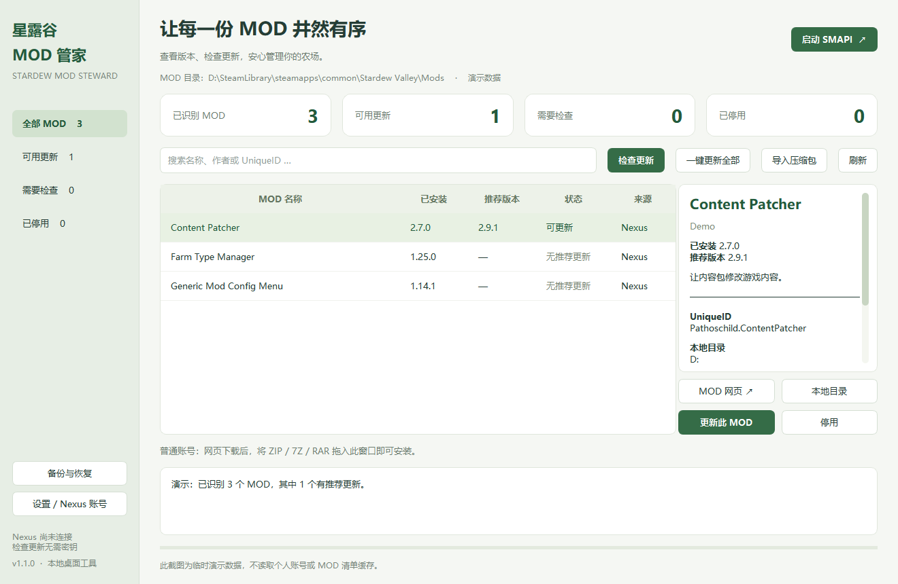

# 星露谷 MOD 管家 · StardewModSteward

一个中文 Windows 桌面工具，用来查看、检查更新和管理 **Stardew Valley + SMAPI** 的 MOD。

[下载 Windows 版](https://github.com/HONGxuanzhao/StardewModSteward/releases/latest) · [详细使用教程](docs/USAGE.md) · [验证范围](docs/VALIDATION.md) · [更新记录](CHANGELOG.md)



> 截图使用演示数据。工具的更新检查结果来自 SMAPI.io，不代表已经验证每个 MOD 的游戏内兼容性。

## 能做什么

- 自动发现 Steam 游戏库中的星露谷安装，参考最近 SMAPI 日志及常见 GOG/Xbox 路径；也可以手动选择游戏目录或 Mods 文件夹。
- 搜索 MOD 名称、作者和 UniqueID，查看安装版本、依赖、更新来源及清单问题。
- 无需 Nexus API Key 即可检查推荐更新。
- 从 Nexus Premium 账号自动下载可明确匹配的更新；普通账号在网页下载后，将压缩包拖进窗口安装。
- 安装前完整备份，默认保留 `config.json`，支持恢复安装批次。
- 列表中直接勾选启用状态，支持 Ctrl/Shift 多选后批量启用或禁用；提供已启用/已禁用筛选和可撤销的操作记录。
- 启停时提示同安装文件夹内可识别的配套组件，默认一并调整，避免只禁用内容包而留下 C# 组件；详情可查看各组件状态。
- 全选当前列表、反选、批量启停；自定义编组支持命名、编辑、复制、删除与整组启停。
- 将编组应用为启用方案：自动包含必需前置，预览启用和禁用名单后统一切换，可从备份撤销。每个游戏安装分别保存编组。
- 过滤清单中的占位更新键；分别显示单个来源失效、查询失败、主包组件和已安装的已知修复版。

## 直接使用 Windows 版

推荐下载 [EXE 安装包](https://github.com/HONGxuanzhao/StardewModSteward/releases/download/v1.3.1/StardewModSteward-v1.3.1-windows-x64-Setup.exe)：关闭已打开的管家后双击运行，按向导安装。默认安装在当前用户的 `%LOCALAPPDATA%\Programs\StardewModSteward`，可创建桌面和开始菜单快捷方式，无需单独安装 Python。可在 Windows「设置 → 应用 → 已安装的应用」中卸载；设置、编组与游戏 MOD 会保留。

也可使用便携 ZIP：

1. 打开 [Releases](https://github.com/HONGxuanzhao/StardewModSteward/releases/latest)，下载 `StardewModSteward-v1.3.1-windows-x64.zip`。
2. **完整解压**到一个可写目录；不要在压缩包内部运行。
3. 双击 `星露谷MOD管家.exe`。保留 EXE 旁的 `_internal` 文件夹和第三方许可文件；这个 EXE 依赖同目录运行库，请勿只拷贝 EXE。
4. 软件会自动找游戏。没有找到或发现多个安装时，打开「设置 / Nexus 账号」→「自动探测」→选择正确安装，也可以浏览或粘贴目录。
5. 点击「检查更新」。普通账号下载更新包后拖入窗口；Premium 账号按下文配置后使用「一键更新全部」。
6. 勾选列表最左侧的「启用」状态可切换 MOD；多选后点击「启用选中」或「禁用选中」。确认窗口发现配套组件时，默认一并调整，请核对完整名单后执行。
7. 点击「新建编组」，命名并勾选成员，或使用「使用当前已启用」。选择编组只筛选列表；「启用整组 / 禁用整组」调整组内项目，「应用为方案」仅启用该组及必需前置，并禁用组外项目。

Windows 包已包含运行环境，**不需要另外安装 Python**。发布版本在 Windows 11 x64 上验证；其他系统未验证。它是未签名的个人工具，不属于 SMAPI、Nexus Mods 或游戏官方产品。

### Nexus 下载方式

| 功能 | 无密钥 / 普通账号 | Nexus Premium + 个人 API Key |
| --- | --- | --- |
| 查看本地 MOD、搜索和依赖 | 支持 | 支持 |
| 查询推荐更新 | 支持，无需密钥 | 支持 |
| 网页下载后拖入安装 | 支持 | 支持 |
| 自动取得下载链接并下载 | 不支持 | 支持符合匹配规则的文件 |
| 软件打开期间按小时自动检查/安装 | 自动检查 | 可同时启用自动安装 |

自动取得 Nexus 下载链接需要 Premium 权限；普通账号的网站下载步骤需要本人完成。[Nexus 官方 API 说明](https://github.com/Nexus-Mods/node-nexus-api/blob/master/docs/classes/_nexus_.nexus.md)

Premium 配置：打开「设置 / Nexus 账号」→「获取个人 API Key」→在 [Nexus 账号页面](https://www.nexusmods.com/users/myaccount?tab=api) 获取个人密钥→粘贴到软件→「验证账号」→「保存设置」。**不要把密钥发到 GitHub Issue 或提交到仓库。**

## 从源码运行

已在 Python 3.13、PySide6 6.9.2、requests 2.32.5 上验证。建议使用独立虚拟环境。以下命令在 Windows PowerShell 中执行：

```powershell
git clone https://github.com/HONGxuanzhao/StardewModSteward.git
cd StardewModSteward
py -3.13 -m venv .venv
.\.venv\Scripts\python.exe -m pip install -r requirements.txt
.\.venv\Scripts\python.exe app.py
```

没有安装 Git 时，也可以点击仓库的 **Code → Download ZIP**，解压后在该目录创建虚拟环境，再执行后两条命令。已安装的 `python` 也可代替 `py -3.13`，本项目尚未逐一验证其他 Python 版本。

### 测试与打包

```powershell
.\.venv\Scripts\python.exe -m unittest -v test_core test_ui test_mod_state test_groups
.\.venv\Scripts\python.exe tools\build_windows.py
```

构建脚本使用当前 Python 环境的 PyInstaller，输出 `dist\星露谷MOD管家\` 和带版本号的 Windows ZIP。测试数据在临时目录中创建。运行本地程序时，请先退出已打开的另一份管理器实例。

制作 EXE 安装包需安装 [Inno Setup 7](https://jrsoftware.org/isdl.php)，本次使用 7.1.1。编译安装器的同时会先构建完整程序和便携 ZIP：

```powershell
.\.venv\Scripts\python.exe tools\build_installer.py --iscc 'C:\Program Files\Inno Setup 7\ISCC.exe'
```

也可用 `ISCC` 环境变量或 PATH 指定编译器。`--skip-build` 只复用已校验为当前版本和源码的程序目录；源码或 EXE 哈希不匹配时会停止。最终输出 `dist\StardewModSteward-v1.3.1-windows-x64-Setup.exe`，以及包含安装版和便携版哈希的 `SHA256SUMS.txt`。

## 重要规则

- **游戏或 SMAPI 运行时不改动 MOD**。安装或恢复前请退出游戏。
- 禁用会把整个 MOD 目录移至专用禁用区，启用时恢复原路径，代码、素材和配置均保留。批量启停按整组操作后的依赖关系校验；不能单独禁用仍被需要的前置，也不能启用缺少前置的内容包。
- 启停批次可以在「备份与恢复」撤销，中途失败会尝试恢复原状态；进程意外退出后的未完成批次也可从这里恢复。目录嵌套、原路径冲突或被外部方式隐藏但缺少记录的目录会提示人工核对。
- 编组保存 MOD ID 名单，不复制 MOD 或保存独立配置。切换编组视图、编辑和删除名单都不会改变实际启用状态；应用为方案前会显示完整变更。新安装的组外 MOD 在下次应用时也会被禁用。
- 应用方案会补齐已安装的必需前置；缺失、重复 ID 或前置版本过低时拒绝执行。编组不控制 SMAPI 的加载顺序，也不迁移或隔离存档。
- 自动更新只选择版本与 SMAPI 推荐一致、subkey 匹配且唯一的 Nexus MAIN 主文件；多个候选、额外新 MOD、前置缺失和目录边界不明确时会跳过，并说明原因。
- MOD 用 UniqueID 匹配，不根据压缩包名字猜测覆盖位置。原目录完整备份，新包替换代码和素材；默认仅继承已有 `config.json`。其他自行修改可在备份中找回。
- 不自动安装 SMAPI 本体、没有 `manifest.json` 的原文件覆盖包或相互嵌套的 MOD 根目录。
- SVE、Ridgeside Village、East Scarp 的部分已识别组件随主包管理，组件与主包的版本分开显示；某些可选文件仍需在网页核对。
- 更新结果、版本号匹配和依赖检查不能代替游戏内验证。MOD 的更新或停用可能影响依赖它的存档。
- ZIP 直接支持。7Z/RAR 需要本机的 `C:\Program Files\7-Zip\7z.exe`；其他安装位置暂不自动查找。
- 非标准 `--mods-path` 布局暂不自动管理。跨平台运行、Linux/macOS 和全盘自定义路径扫描不在当前验证范围。

## 设置、数据与备份

| 内容 | 位置 |
| --- | --- |
| 设置、检查缓存、日志 | `%LOCALAPPDATA%\StardewModSteward` |
| 自定义编组 / 上次编组备份 | `%LOCALAPPDATA%\StardewModSteward\groups.json` / `groups.previous.json` |
| 已下载更新包 | `%LOCALAPPDATA%\StardewModSteward\downloads` |
| 完整安装备份和事务记录 | `游戏目录\.stardew-mod-steward\backups` |
| 禁用的 MOD | `游戏目录\.stardew-mod-steward\disabled` |

Nexus API Key 使用当前 Windows 用户的 DPAPI 加密。检查更新会向 SMAPI.io 发送 MOD ID、更新键、版本、游戏/SMAPI 版本与平台；密钥只用于 Nexus 官方 API，不上传存档、MOD 文件内容或本机日志。完整使用与恢复方法见 [教程](docs/USAGE.md)。

## 源码结构

```text
app.py                 中文 Qt 界面、后台任务及操作入口
core.py                自动发现、清单扫描、更新检查、Nexus 下载、安装与恢复
test_core.py           核心逻辑与文件安全回归测试
test_ui.py             基于临时数据的界面测试
test_mod_state.py      单个/批量启停、依赖、失败回滚和恢复测试
test_groups.py         编组持久化、必需前置、方案切换与混合事务恢复测试
tools/build_windows.py Windows 打包及便携包生成
tools/build_installer.py EXE 安装包构建和版本校验
tools/windows_installer.iss Inno Setup 安装、快捷方式及卸载配置
docs/                  使用教程、验证范围和演示截图
```

项目仅包含本工具的源码和文档，不包含游戏文件、第三方 MOD、用户密钥、MOD 清单缓存或个人备份。第三方组件及其来源见 [THIRD_PARTY_NOTICES.md](THIRD_PARTY_NOTICES.md)。

接口依据：[SMAPI 更新检查 API](https://github.com/Pathoschild/SMAPI/blob/develop/docs/technical/web.md)、[SMAPI 更新键说明](https://wiki.stardewvalley.net/Modding:Modder_Guide/APIs/Update_checks)、[Nexus 官方 API 客户端](https://github.com/Nexus-Mods/node-nexus-api)。
