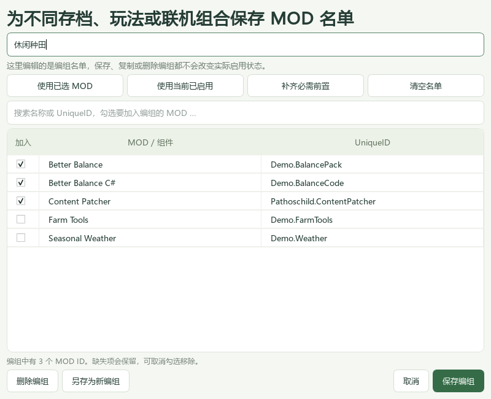

# 使用教程

## 1. 选择正确的 MOD 文件夹

首次启动会查找带有 `StardewModdingAPI.exe` 和 `Mods` 的游戏目录。Steam 的多个游戏库、游戏安装清单和最近 SMAPI 日志都会参与发现，不会遍历整块硬盘。

如果显示的目录不对：

1. 点击「设置 / Nexus 账号」。
2. 点击「自动探测」，从「发现的安装」选择正确位置。
3. 或点击「浏览」，选择游戏目录。直接粘贴 `Mods` 文件夹或 SMAPI EXE 路径也会转换到游戏目录。
4. 保存后查看主窗口顶部显示的 **MOD 目录**。

有效的手动选择会优先保留；首次找到多个安装时优先采用较近的使用记录。最近日志可能是旧安装留下的，请核对列表与实际目录。当前版本不管理自定义 `--mods-path` 位于游戏目录之外的情况。

## 2. 查看列表与状态

输入 MOD 名称、作者或 UniqueID 搜索。左侧提供全部、已启用、已禁用、可更新和需要检查筛选。单击 MOD 可查看右侧详细版本、来源、路径、启用状态和依赖；「MOD 网页」打开对应下载页，「本地目录」打开安装位置。

| 状态 | 含义 |
| --- | --- |
| 可更新 | SMAPI 接口推荐了比当前版本更新的版本；仍需核对安装条件。 |
| 无推荐更新 | 来源返回了版本信息，当前没有推荐更新；不等于已验证兼容性。 |
| 随主包检查 | 组件与同目录主包有已识别关系，通过主包管理，不将两者版本直接比较。 |
| 随 SMAPI 更新 | SMAPI 自带组件，使用官方 SMAPI 安装程序升级。 |
| 已装修复版 | 已装版本号与 SMAPI 目录记录的非官方修复版一致；没有据此确认实际运行。 |
| 无独立更新源 | 当前没有取得可独立比较的远端版本。 |
| 检查失败 | 查询出现错误且没有取得有效版本，查看右侧原因后重试。 |
| 停止维护 / 已被替代 / 兼容性提示 | SMAPI 兼容性目录有相关记录，需要结合已装版本判断。 |
| 需要检查 | 本机有重复 ID、缺少前置等问题；详情中有具体原因。 |
| 需网页核对 | 可选文件没有独立可比较版本，需要本人在下载页核对。 |

清单中 `Nexus:???`、`Nexus:-1`、`Ignore This` 等占位更新键只会在本软件的请求中被过滤，原清单不改动。若 Nexus 单个来源失效但已取得其他来源的版本，则会使用有效信息，并保留来源错误到详情。

## 3. 普通账号更新

1. 点击「检查更新」，选中要更新的 MOD。
2. 点击「MOD 网页」，在 Nexus 页面阅读版本、前置与文件说明，下载所需 ZIP、7Z 或 RAR。
3. 退出游戏和 SMAPI。
4. 把压缩包拖入管家，或点击「导入压缩包」。
5. 检查安装预览的 MOD 名称与版本，点击「安装并备份」。

一个包可以包含多个相互独立的 MOD，软件会预览整个包。安装器用清单 ID 找到原目录，备份完整旧目录后替换；默认保留已有的各层 `config.json`。请勿导入覆盖游戏原文件的 MOD 或 SMAPI 安装程序。

## 4. Premium 一键与自动更新

1. 设置中点击「获取个人 API Key」，前往自己的 Nexus 账号页面取得个人密钥。
2. 粘贴密钥，点击「验证账号」，确认显示 Premium，然后保存。
3. 点击「更新此 MOD」或「一键更新全部」。组件行的按钮可能显示「更新主包」。
4. 若要持续自动处理，在设置里同时开启自动检查和自动安装，并保持管家运行。

软件打开时及每小时自动检查。自动安装只处理可明确匹配的主文件；游戏运行时会停止修改。软件关闭后不执行后台更新。普通账号无法直接使用 Premium 下载接口，请使用网页下载加导入流程。

以下情况会跳过自动安装，并写入操作记录：多个主文件候选、推荐来源不在 Nexus、压缩包包含额外新 MOD、缺前置、重复 ID、嵌套目录或需要核对的兼容性提示。可先解决问题，再手动下载并导入合适的包。

## 5. 恢复备份

点击「备份与恢复」选择安装批次，再点击「恢复选中的备份」。先退出游戏，按**从新到旧**的顺序恢复。恢复前也会保留当前版本，方便人工取回文件。

从 v1.2.0 起，这里也包含启用/禁用批次。恢复启停批次会重新检查依赖，然后撤销该批次的状态变化；中断的启停批次会恢复到操作前状态。恢复本身会留下新的启停记录。完成的批次依时间从新到旧撤销，避免跨过后续操作。

备份位于 `游戏目录\.stardew-mod-steward\backups`，其中 `transaction.json` 记录操作状态。发生安装中断时，先恢复该批次，再做新的修改。保留尚未完成或恢复的事务文件；磁盘损坏等异常仍可能需要从备份中人工取回文件。

## 6. 单个或批量启用、禁用 MOD

1. 退出游戏和 SMAPI。
2. **单个切换：**点击列表最左侧「启用」列的勾选状态，或选中 MOD 后点击详情区的「启用 / 禁用」。
3. **批量操作：**按住 Ctrl 逐个多选，或用 Shift 连续选择，也可点击「全选列表 / 反选」，然后点击「启用选中」或「禁用选中」。全选与反选只作用于当前编组、搜索和状态筛选后可见的行，不会直接改变启用复选框。
4. 阅读确认窗口中的 MOD 名单。发现配套组件时，默认勾选「同时启用 / 禁用配套组件（推荐）」，名单与数量会包含这些组件；取消该选项才会只调整所选项。确认后执行，取消整个窗口不会移动文件。
5. 左侧「已启用 / 已禁用」可筛选当前状态。禁用后的项目仍保留在列表中，可随时重新选择启用。

禁用将完整目录移到 `游戏目录\.stardew-mod-steward\disabled`，启用时依据记录恢复原路径；不会修改 MOD 的 DLL、素材、清单或配置。程序会添加和移除自己的 `.steward-disabled.json` 路径记录。v1.1 保存的禁用记录仍可识别。

一个下载包可能含多个 SMAPI 组件。例如 **Better Balance** 是内容包，**Better Balance C#** 是代码组件；只禁用前者，后者仍会加载。详情区会显示可识别配套组件及各自状态。识别要求原路径在同一非 Mods 根文件夹内、作者相同且有明确的必需依赖关系；禁用组件使用保存的原路径识别。通用框架不会仅因是前置就被加入，无法满足条件的组件仍需搜索名称、查看清单并多选。

依赖检查按**整批执行后的状态**进行。例如，一个内容包依赖框架时，单独禁用框架会被阻止；把内容包和框架一起选择，则可以整批禁用，也可整批重新启用。前置版本过低、同 ID 冲突或原路径已被占用时，会停止并说明原因。

目录互相嵌套时，请先整理为独立目录。用户在外部把目录名改为点开头而隐藏的 MOD，由于没有软件保存的原路径记录，仍需要本人在资源管理器中调整。已有存档可能依赖被禁用的 MOD，本工具不迁移存档。

每次启停都有事务记录，可以在「备份与恢复」撤销。操作中途失败会尝试回滚；如提示仍需恢复，先处理该中断批次，再进行下一次修改。

## 7. 自定义编组和启用方案

### 创建、编辑和复制

1. 点击主窗口上方「新建编组」，输入名称，例如「休闲种田」「大型扩展」或「联机存档」。
2. 勾选要纳入名单的 MOD。也可点击「使用已选 MOD」或「使用当前已启用」；「补齐必需前置」将已安装的依赖一起加入草稿。
3. 点击「保存编组」。名称需为 1–60 个字符，同一游戏安装内不能重名。
4. 下拉框选择编组后，「编辑 / 复制」可修改名称和成员、另存为新编组，或删除名单。复制时自动生成可用名称。

主列表的「加入编组 / 移出编组」只编辑选中项目的成员关系。未选择具体编组时，「加入编组」会打开新建窗口。缺失的 MOD 仍保留在编组编辑器中，可以取消勾选移除，软件不会自行丢弃名单。

### 筛选、整组启停与应用方案

| 操作 | 实际效果 |
| --- | --- |
| 下拉框选择编组 | 只筛选列表，可继续叠加搜索和左侧状态筛选；不修改启用状态。 |
| 全选列表 / 反选 | 选择当前可见行，供后续批量操作使用。 |
| 启用选中 / 禁用选中 | 调整选中行，可确认是否同时调整可识别配套组件。 |
| 启用整组 / 禁用整组 | 调整该组所有已安装成员，不受搜索或状态筛选限制；仍进行配套组件提示与依赖检查。 |
| 应用为方案 | **仅启用该组及其必需前置，禁用组外 MOD**，在确认窗口显示完整变更。 |

例如「休闲种田」只有 Better Balance 内容包时，应用方案会自动包含其必需的 C# 组件和 Content Patcher；其他不属于该组且不是必需前置的 MOD 会被禁用。可选依赖不会自动加入。自动包含的前置会显示在预览中，编组原始名单保持原样；需要保存展开后的名单，可在编辑器点击「补齐必需前置」。

应用空编组会禁用全部 MOD，确认窗口会明确提示。缺失成员、缺失前置、重复 ID 或版本要求不满足时会停止，不会猜测采用哪份文件。若确认后有人安装、移动或改动 MOD 清单，软件会要求刷新并重新确认。

应用方案把所有启用和禁用放在同一个事务中，失败时回滚，可在「备份与恢复」撤销。游戏和 SMAPI 运行时禁止启停；名单编辑不需要退出游戏。首次使用可先保存「当前已启用」作为一份基准编组。

### 保存位置与边界

编组按游戏安装目录分开存放在 `%LOCALAPPDATA%\StardewModSteward\groups.json`，重启软件后保留，并记住上次查看的编组。每次编辑前将上一份名单文档保留为同目录 `groups.previous.json`。编组文件损坏时原文件不会被覆盖，其他查看和管理功能仍可使用；恢复名单文件前请先关闭管家并保留损坏文件副本。

成员按清单 UniqueID 关联，更新版本、禁用后移动路径不会失去成员关系。编组不是 MOD 文件或独立配置的副本，不保存各组的 `config.json`，不控制 SMAPI 加载顺序，也不隔离存档。此功能不会为每份存档自动选择编组；启动前请确认实际启用状态和所用存档相符。

## 8. 常见问题

**找不到游戏：**确认已安装 SMAPI，选择同时含 `StardewModdingAPI.exe` 和 `Mods` 的目录；纯原版游戏目录不能用于当前管理器。

**点击更新提示账号权限：**检查使用的是否为自己的个人 API Key，以及账号是否有 Premium 下载权限。检查更新本身不需要密钥。

**7Z/RAR 无法解压：**当前调用 `C:\Program Files\7-Zip\7z.exe`，请在该标准位置安装官方 7-Zip，或使用 ZIP 包。

**重复 ID 或嵌套目录：**先用「本地目录」核查重复和层级，确认应保留哪一份。软件不会猜测并删除它们。

**界面结果是旧的：**顶部与底部会显示目录和检查时间。点击「刷新」重新扫描，再点击「检查更新」联网更新结果。

**禁用了 Better Balance，但 SMAPI 仍显示 Better Balance C#：**这是两个不同的清单。确认内容包和 C# 组件都在「已禁用」中；v1.2.1 的确认窗口默认包含可识别配套组件。退出并重新启动 SMAPI 后再看新日志，已运行的游戏不会卸载已经加载的组件。

**清单显示已装修复版但仍有游戏问题：**这只说明版本号匹配，需结合 SMAPI 新日志和实际游戏复现检查。

**运行第二份程序没有出现新窗口：**当前设计只允许同一 Windows 用户同时打开一个实例，切回已打开的窗口。

**问题反馈：**可在 GitHub Issue 描述系统、工具版本、报错步骤及必要的错误文字。分享日志前检查个人路径和信息，绝不贴出 Nexus API Key、账号凭据或整个设置文件。
