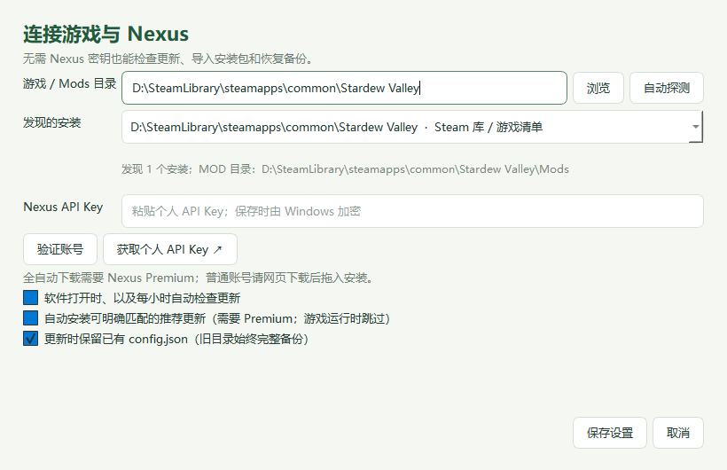

# 使用教程

## 1. 选择正确的 MOD 文件夹

首次启动会查找带有 `StardewModdingAPI.exe` 和 `Mods` 的游戏目录。Steam 的多个游戏库、游戏安装清单和最近 SMAPI 日志都会参与发现，不会遍历整块硬盘。

如果显示的目录不对：

1. 点击「设置 / Nexus 账号」。
2. 点击「自动探测」，从「发现的安装」选择正确位置。
3. 或点击「浏览」，选择游戏目录。直接粘贴 `Mods` 文件夹或 SMAPI EXE 路径也会转换到游戏目录。
4. 保存后查看主窗口顶部显示的 **MOD 目录**。

有效的手动选择会优先保留；首次找到多个安装时优先采用较近的使用记录。最近日志可能是旧安装留下的，请核对列表与实际目录。当前版本不管理自定义 `--mods-path` 位于游戏目录之外的情况。

## 2. 查看列表与状态

输入 MOD 名称、作者或 UniqueID 搜索。左侧提供全部、可更新、需要检查和已停用筛选。单击 MOD 可查看右侧详细版本、来源、路径和依赖；「MOD 网页」打开对应下载页，「本地目录」打开安装位置。

| 状态 | 含义 |
| --- | --- |
| 可更新 | SMAPI 接口推荐了比当前版本更新的版本；仍需核对安装条件。 |
| 无推荐更新 | 来源返回了版本信息，当前没有推荐更新；不等于已验证兼容性。 |
| 随主包检查 | 组件与同目录主包有已识别关系，通过主包管理，不将两者版本直接比较。 |
| 随 SMAPI 更新 | SMAPI 自带组件，使用官方 SMAPI 安装程序升级。 |
| 已装修复版 | 已装版本号与 SMAPI 目录记录的非官方修复版一致；没有据此确认实际运行。 |
| 无独立更新源 | 当前没有取得可独立比较的远端版本。 |
| 检查失败 | 查询出现错误且没有取得有效版本，查看右侧原因后重试。 |
| 停止维护 / 已被替代 / 兼容性提示 | SMAPI 兼容性目录有相关记录，需要结合已装版本判断。 |
| 需要检查 | 本机有重复 ID、缺少前置等问题；详情中有具体原因。 |
| 需网页核对 | 可选文件没有独立可比较版本，需要本人在下载页核对。 |

清单中 `Nexus:???`、`Nexus:-1`、`Ignore This` 等占位更新键只会在本软件的请求中被过滤，原清单不改动。若 Nexus 单个来源失效但已取得其他来源的版本，则会使用有效信息，并保留来源错误到详情。

## 3. 普通账号更新

1. 点击「检查更新」，选中要更新的 MOD。
2. 点击「MOD 网页」，在 Nexus 页面阅读版本、前置与文件说明，下载所需 ZIP、7Z 或 RAR。
3. 退出游戏和 SMAPI。
4. 把压缩包拖入管家，或点击「导入压缩包」。
5. 检查安装预览的 MOD 名称与版本，点击「安装并备份」。

一个包可以包含多个相互独立的 MOD，软件会预览整个包。安装器用清单 ID 找到原目录，备份完整旧目录后替换；默认保留已有的各层 `config.json`。请勿导入覆盖游戏原文件的 MOD 或 SMAPI 安装程序。

## 4. Premium 一键与自动更新

1. 设置中点击「获取个人 API Key」，前往自己的 Nexus 账号页面取得个人密钥。
2. 粘贴密钥，点击「验证账号」，确认显示 Premium，然后保存。
3. 点击「更新此 MOD」或「一键更新全部」。组件行的按钮可能显示「更新主包」。
4. 若要持续自动处理，在设置里同时开启自动检查和自动安装，并保持管家运行。

软件打开时及每小时自动检查。自动安装只处理可明确匹配的主文件；游戏运行时会停止修改。软件关闭后不执行后台更新。普通账号无法直接使用 Premium 下载接口，请使用网页下载加导入流程。

以下情况会跳过自动安装，并写入操作记录：多个主文件候选、推荐来源不在 Nexus、压缩包包含额外新 MOD、缺前置、重复 ID、嵌套目录或需要核对的兼容性提示。可先解决问题，再手动下载并导入合适的包。

## 5. 恢复备份

点击「备份与恢复」选择安装批次，再点击「恢复选中的备份」。先退出游戏，按**从新到旧**的顺序恢复。恢复前也会保留当前版本，方便人工取回文件。

备份位于 `游戏目录\.stardew-mod-steward\backups`，其中 `transaction.json` 记录操作状态。发生安装中断时，先恢复该批次，再做新的修改。保留尚未完成或恢复的事务文件；磁盘损坏等异常仍可能需要从备份中人工取回文件。

## 6. 启用和停用

停用将完整 MOD 目录移到游戏目录下的专用停用区，启用移回原位置。软件会阻止停用仍被其他 MOD 必须依赖的项目。请留意旧存档可能依赖该 MOD；本工具不迁移存档。

## 7. 常见问题

**找不到游戏：**确认已安装 SMAPI，选择同时含 `StardewModdingAPI.exe` 和 `Mods` 的目录；纯原版游戏目录不能用于当前管理器。

**点击更新提示账号权限：**检查使用的是否为自己的个人 API Key，以及账号是否有 Premium 下载权限。检查更新本身不需要密钥。

**7Z/RAR 无法解压：**当前调用 `C:\Program Files\7-Zip\7z.exe`，请在该标准位置安装官方 7-Zip，或使用 ZIP 包。

**重复 ID 或嵌套目录：**先用「本地目录」核查重复和层级，确认应保留哪一份。软件不会猜测并删除它们。

**界面结果是旧的：**顶部与底部会显示目录和检查时间。点击「刷新」重新扫描，再点击「检查更新」联网更新结果。

**清单显示已装修复版但仍有游戏问题：**这只说明版本号匹配，需结合 SMAPI 新日志和实际游戏复现检查。

**运行第二份程序没有出现新窗口：**当前设计只允许同一 Windows 用户同时打开一个实例，切回已打开的窗口。

**问题反馈：**可在 GitHub Issue 描述系统、工具版本、报错步骤及必要的错误文字。分享日志前检查个人路径和信息，绝不贴出 Nexus API Key、账号凭据或整个设置文件。
